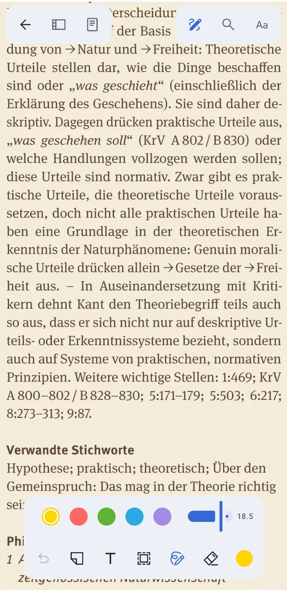
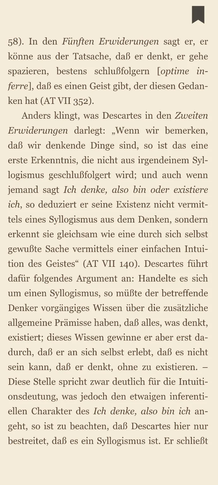
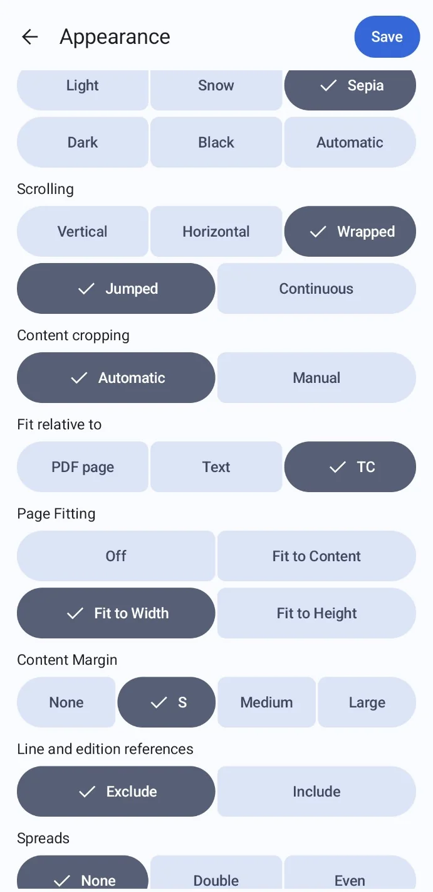
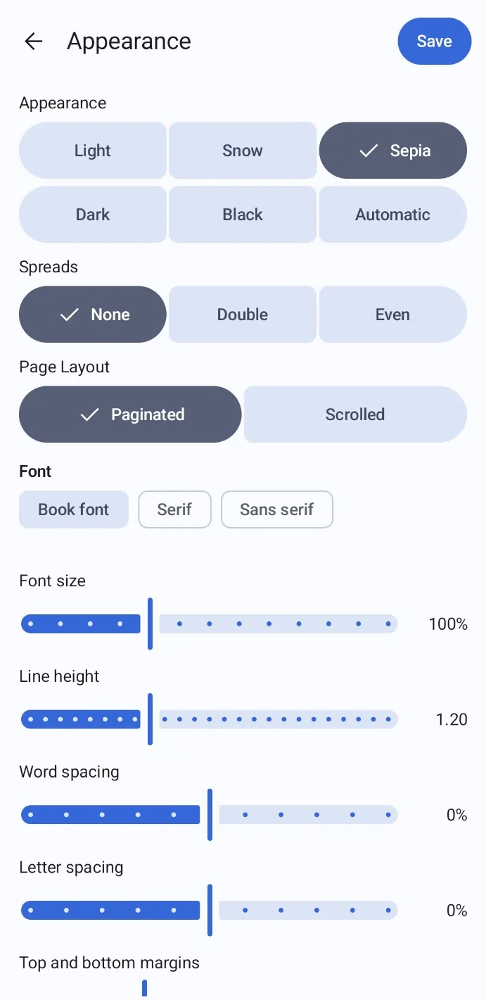
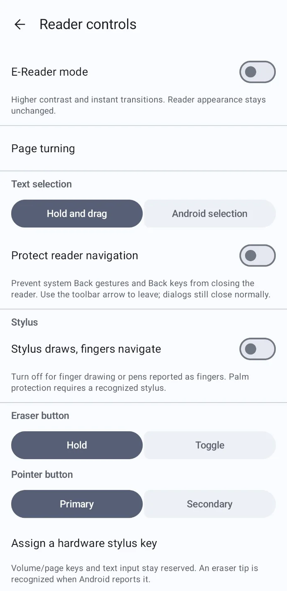
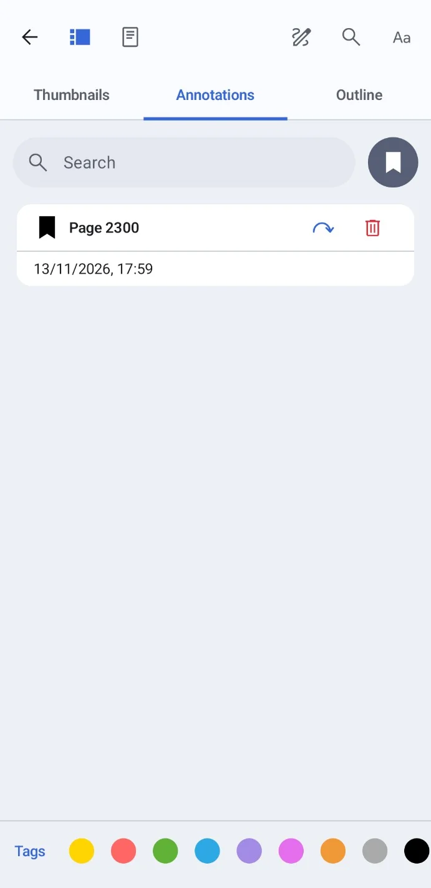

# Motero

[](https://github.com/OptikerGerhardt/Motero/actions/workflows/motero.yml)

Motero is an unofficial fork of **[Zotero for Android](https://github.com/zotero/zotero-android)**, focused on reading and annotating PDFs and EPUBs on BOOX e-readers and Android phones. It adds reading controls, page fitting and cropping, and annotation tools tailored to that workflow.

This fork is maintained independently and is not affiliated with or endorsed by Zotero or the Corporation for Digital Scholarship.

## Motero 1.1

[1.1.2 / Build 328](https://github.com/OptikerGerhardt/Motero/releases/tag/v1.1.2-328) improves system-bar spacing, restores room for the full pen palette, puts Page Turning directly in Reader Controls, keeps double-tapped column focus during SmartScroll and separates Continuous pages more clearly. [Changes and limits](docs/READER_328.md).

[1.1.1 / Build 327](https://github.com/OptikerGerhardt/Motero/releases/tag/v1.1.1-327) fixes the Reader toolbar Back arrow when Protect reader is enabled, on phones and tablets. Explicit exit bypasses Android system Back protection; the protection still handles system navigation.

[Motero 1.1 / Build 326](https://github.com/OptikerGerhardt/Motero/releases/tag/v1.1.0-326) adds 200 ms drag highlighting, unified Zotero-style Reader Controls with nested Page Turning, standard Android Back protection, wider EPUB bookmark tapping, precise EPUB note anchors and a quick palette that stays above highlights. Adaptive dock transitions and stable reading frames accompany improved running-head, separator, author-list and publisher-notice recognition. [Changes and verification limits](docs/READER_326.md).

## Features

- Optional app-wide E-Reader mode, stylus-only annotation with finger navigation, palm protection, configurable eraser buttons and local input diagnostics. [Controls and hardware limits](docs/E_READER_AND_STYLUS.md).

- Direct drag highlighting in PDFs and EPUBs, touch editing of existing annotations, Zotero tags, and an animated bottom PDF dock with annotation Undo, long-press Redo, inline color/size controls, and area/stroke erasing.
- Black bookmark flags, a bookmark filter, and direct jump/delete shortcuts. Every annotation card offers a direct jump and its options in the header.
- Reader appearance applied at startup, matching system-bar contrast and page previews.
- Continuous cropped PDF pages, temporary two-finger access to full pages, and an overview that stays open when two complete pages are visible.
- Font size, font choice, spacing and percentage-based side margins, plus independent EPUB top/bottom margins for EPUBs and Reading Mode. EPUB controls float above the text without moving the reading position.
- Automatic content fitting with controls for margins and marginal notes, local chapter/layout learning, Roman and Arabic folio detection, a text-only analysis shortcut, and a bounded geometry cache.
- Automatic or manual content cropping, shared by the page-fitting modes. Manual frames for all, odd, or even pages are saved per attachment.
- SmartScroll, hardware-button navigation, and edge taps in vertical, horizontal, and wrapped PDF layouts.
- Continuous scrolling or single-page swipe navigation: short pages are centered and tall pages enter at the reading edge, with two-finger access to the page overview.
- A top-right bookmark shortcut for the centered reading page: tap to add a black bookmark, then tap again to remove it. Existing bookmark colors are preserved.
- Tag suggestions ranked by use in the current document and library, with explicit creation of new tags.
- EPUB navigation, local reading-position restoration, and progress displays cycled by tapping the footer, including hidden.
- Global reader controls for direct/Android text selection and optional protection against Android system Back keys/gestures, plus ordinary volume-key list scrolling. [Reader changes](docs/READER_NEXT_UPDATE.md).

View cropping does not modify the PDF file or annotation coordinates. Manual crop settings are stored locally and are not synchronized with Zotero.

## Android screenshots

The following screenshots were captured from the Motero Android app. They show the native reader interface and settings; the Android status and navigation bars have been cropped for presentation.

| Reading and annotations | Bookmark navigation |
| --- | --- |
|  |  |
| **Reader appearance** | **Typography and layout** |
|  |  |
| **Reader and stylus controls** | **Bookmarks list** |
|  |  |


These are device screenshots of the Android interface. They complement the browser-rendered previews below, which use a synthetic document and do not represent the complete native Android UI.

## Install and update

**Requires Android 9 or later.** Download `Motero_Build<number>.apk` from the [latest release](https://github.com/OptikerGerhardt/Motero/releases/latest). Each release also includes source code, test reports, and SHA-256 checksums.

**Before installing or updating:** Back up your Zotero data and any important PDFs. Motero is an unofficial, experimental fork; automated checks do not replace testing on your particular device or with your Zotero account. See [Tests and project status](#tests-and-project-status) for verification limits.

Release APKs are signed with a dedicated Motero key. The public certificate and signing policy are available in [signing/](signing/). The application ID is `org.zotero.android.debug`; this is retained for compatibility with earlier Motero installations. Release APKs are not debuggable.

Use **Build 307 or later** when updating an earlier Motero test build. Build 306 has a receiver-permission conflict that prevents this migration. The corrected update retains the application ID and uses a new internal permission alongside signing-key rotation. Back up your data before updating. A successful Build 307 update has been reported on a Pixel 8 running GrapheneOS; BOOX confirmation is still pending. See [SECURITY.md](SECURITY.md).

You can also track this repository with [Obtainium](https://github.com/ImranR98/Obtainium). Use the APK filename filter `^Motero_Build[0-9]+\.apk$`.

**Motero 1.0** starts with Build 315. Earlier releases are labeled Alpha. Release titles are separate from the retained build tags and increasing Android version codes, so existing Obtainium installations can continue updating. Keep the default tag-based version detection; custom filters matching old release titles may need updating.

## About this hobby project and AI-assisted development

Motero started as a personal hobby project to make reading and annotating academic PDFs on a BOOX e-reader work better for my own needs. I'm relatively new to software development, and the Motero-specific changes, their integration, tests, and build configuration have been developed largely with **ChatGPT / OpenAI Codex**. I define the requirements, try out changes, and make the maintenance and release decisions. This is not a professionally maintained alternative to Zotero.

There are automated tests and documented verification steps, but AI-generated code and passing tests do **not** guarantee correctness, security, or compatibility with every device. In particular, new reader behavior on physical BOOX devices and synchronization with live Zotero accounts require separate verification; see [Tests and project status](#tests-and-project-status) and [device-specific limitations](docs/E_READER_AND_STYLUS.md).

Motero is entirely unofficial. I do not expect Zotero's developers to support this fork or incorporate its changes. Feedback is welcome, including concerns or preferences from upstream maintainers about how the fork is presented, distributed, or maintained. Please report Motero-specific problems here rather than in Zotero's official support channels.

The underlying Zotero code and incorporated community contributions retain their original authorship. Motero includes selected pull requests and fixes from the upstream projects; some have been merged upstream, while others were incorporated into this fork from open pull requests. [UPSTREAM_CHANGES.md](UPSTREAM_CHANGES.md) lists the contributions and their upstream status.

## Thanks to Zotero and its contributors

Motero exists because of the work behind **[Zotero](https://www.zotero.org/)**, **[Zotero for Android](https://www.zotero.org/support/android)**, and **[Zotero Reader](https://github.com/zotero/reader)**.

Thank you to the Corporation for Digital Scholarship and to the developers, maintainers, contributors, translators, reviewers, and testers for the time, care, and effort invested in these projects. Their work on reference management, synchronization, document reading, annotations, and open infrastructure is the foundation of this fork. Credit also belongs to the original authors of the pull requests incorporated into Motero.

Upstream source repositories: [Zotero](https://github.com/zotero/zotero), [Zotero for Android](https://github.com/zotero/zotero-android), and [Zotero Reader](https://github.com/zotero/reader).

## Build from source

Requirements: JDK 17, Node.js 24, Python 3.12, Android SDK package `platforms;android-37.0`, and Build Tools 36.0.0. Current Android SDK command-line tools require JDK 21 for SDK installation; the app itself builds with JDK 17. The Gradle wrapper downloads the pinned Gradle distribution and checks its SHA-256 checksum.

```sh
git clone --recurse-submodules https://github.com/OptikerGerhardt/Motero.git
cd Motero
python3 scripts/prepare_reader_assets.py
cd reader
npm ci --no-audit --no-fund
npm test
npx webpack --config-name android
cd ..
python3 scripts/package_reader_assets.py
./gradlew :app:testDevDebugUnitTest :app:assembleDevDebug --init-script scripts/test_jvm_agent.gradle --no-build-cache
```

The development APK is written to `app/build/outputs/apk/dev/debug/app-dev-debug.apk`. It uses a public development key and must not be distributed as a production release. See [docs/RELEASING.md](docs/RELEASING.md) for release builds and private signing.

The customized reader is pinned as a submodule from this repository's [`reader` branch](https://github.com/OptikerGerhardt/Motero/tree/reader). Initialize submodules when cloning. The pinned PDF.js distribution and runtime packages are documented in [vendor/README.md](vendor/README.md).

## Tests and project status

The release workflow runs reader and Android unit tests, browser checks, and publication/signing checks. Before publishing, it also exercises a real update from Build 303 on Android API 31 and 35, verifies private test-data and UID retention, and rejects updates or internal-permission access using the old public key. Versioned reports accompany each release. New reader behavior on physical devices, BOOX keyboard behavior, and synchronization with a live Zotero account require separate testing.

Browser checks use Playwright 1.56.1 and Chromium. With Playwright installed and available through `NODE_PATH`, run:

```sh
python3 scripts/run_browser_checks.py --browser /usr/bin/chromium
```

Further development notes: [feature plan](FEATUREPLAN.md), [changelog](CHANGELOG.md), and [build verification](BUILD_STATUS.md) (in German).

## Contributing and support

Report Motero bugs, compatibility issues, and feature requests in [this repository's issues](https://github.com/OptikerGerhardt/Motero/issues), **not to Zotero's official support team**. Include the build number, device, Android version, and steps to reproduce. Constructive technical feedback and suggestions on how to maintain this fork responsibly are welcome. See [CONTRIBUTING.md](CONTRIBUTING.md) for contribution guidance and [SECURITY.md](SECURITY.md) for security reports. Please keep personal documents and credentials out of reports.

## License

Motero's derived application code is distributed under the **GNU Affero General Public License, version 3 (AGPLv3)**, following the upstream license. See [LICENSE](LICENSE), the preserved upstream [COPYING](COPYING), and [NOTICE.md](NOTICE.md). Dependencies retain their respective licenses and copyright notices.

Zotero is a registered trademark of the Corporation for Digital Scholarship. The Motero name identifies this independent fork.
